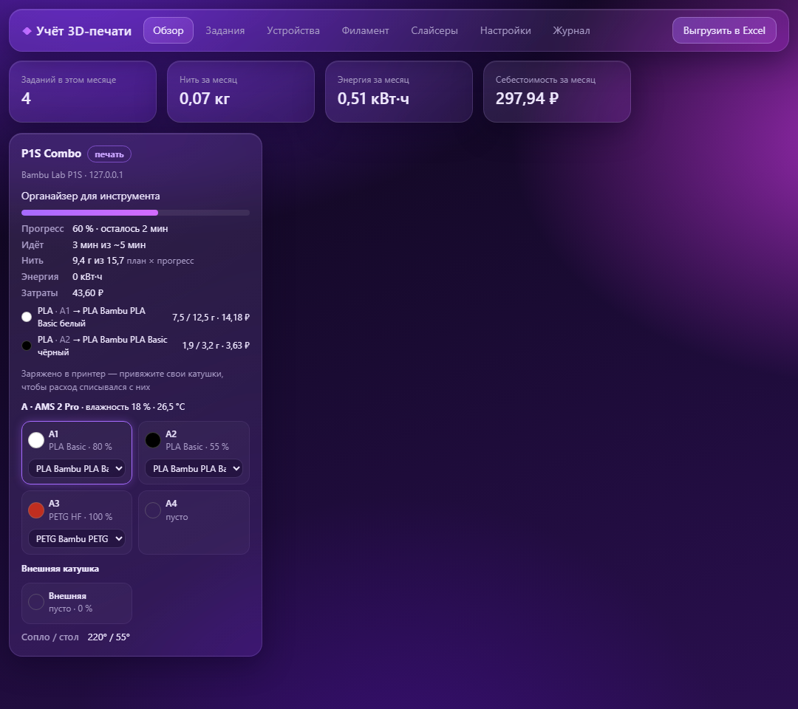
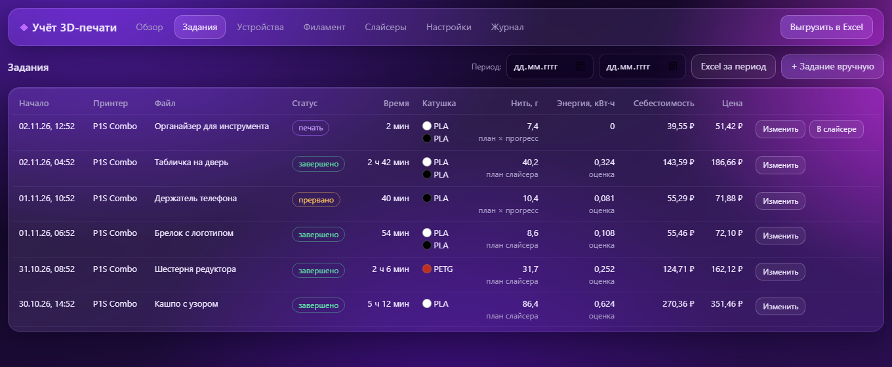
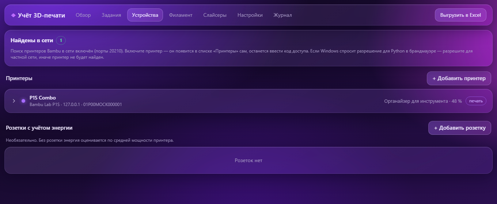
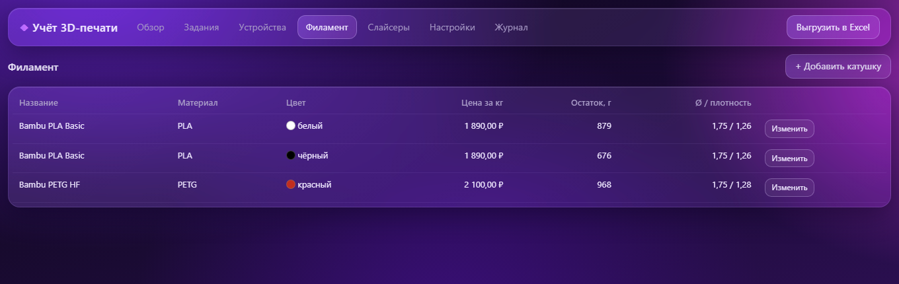
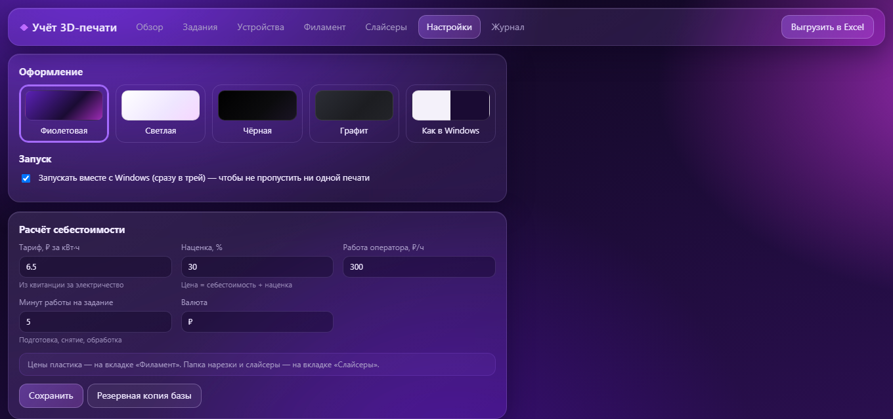
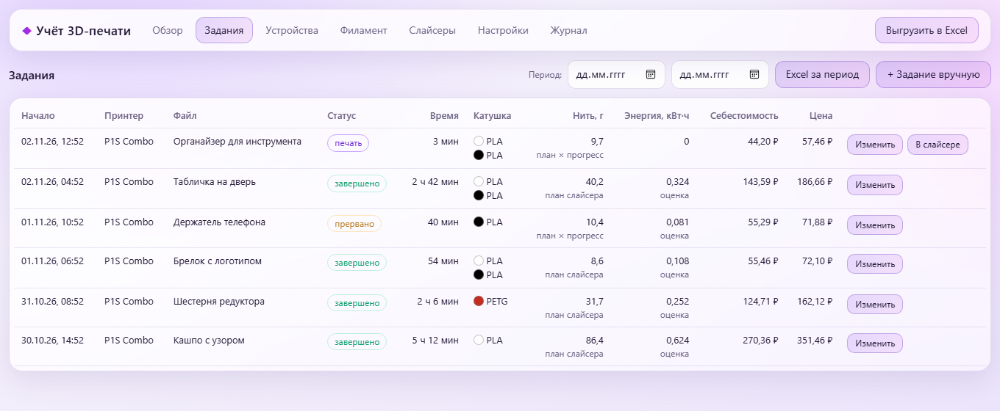

# Учёт 3D-печати

**Версия 0.0.3** · Windows · бесплатно, открытый код (MIT)

Настольное приложение для тех, кто печатает на 3D-принтере и хочет знать, **сколько на самом деле стоит каждая деталь**.
Оно само следит за принтером: когда начинается печать, заводит задание, считает, сколько ушло пластика и электричества,
и выдаёт себестоимость и цену с наценкой. Всё хранится у вас на компьютере, выгружается в Excel.

> ⚠️ **Первая версия.** Всё проверено автоматическими тестами и на эмуляторах принтеров и розеток,
> но **ещё не на реальном оборудовании**. Если что-то работает не так — пожалуйста,
> [напишите об ошибке](../../issues/new/choose): это сильно поможет.



## Что умеет

- **Само находит принтер Bambu Lab в сети** (как Bambu Studio) и добавляет его: модель, IP, серийный номер.
  Остаётся ввести код доступа с экрана принтера. Если роутер выдал принтеру новый IP — адрес обновится сам.
- **Само заводит задания печати.** Запустили печать из Bambu Studio, Bambu Handy или с экрана —
  задание появилось, по окончании посчитана себестоимость. Прервали — учтена только напечатанная часть.
- **Многоцветная печать (AMS).** Из файла задания берутся все пластики детали — тип, цвет и граммы каждого.
  Каждый сопоставляется с вашей катушкой (через слот AMS или по типу и цвету), стоимость и остаток
  считаются по каждой катушке отдельно.
- **Видно, что заряжено в AMS:** цвет, тип, остаток в каждом слоте; тип блока (AMS, AMS 2 Pro, AMS HT),
  влажность, температура и сушка — если принтер это сообщает.
- **Себестоимость:** пластик, электричество (по розетке с учётом энергии или по средней мощности),
  амортизация принтера и работа оператора; цена = себестоимость + ваша наценка.
- **Склад филамента:** остатки катушек уменьшаются сами; параметры новой катушки можно взять
  из профилей ваших слайсеров.
- **Excel:** задания, разбивка по пластикам, катушки — за всё время или за период.
- **Все слайсеры:** Bambu Studio, OrcaSlicer, Creality Print, ElegooSlicer, Anycubic Slicer Next, QIDI Studio,
  Snapmaker Orca, PrusaSlicer, Cura и другие находятся сами; профили пластика берутся из них,
  файл задания открывается в нужном слайсере одной кнопкой. Любой другой слайсер — добавить вручную.
- **Работает в фоне:** закрытие окна сворачивает в трей, учёт продолжается; можно включить запуск вместе с Windows.
- **Темы:** фиолетовая, светлая, чёрная, графит, как в Windows.

## Скриншоты

<table>
<tr>
<td width="50%"><b>Задания</b> — себестоимость и цена каждой детали, пластики цветом<br></td>
<td width="50%"><b>Устройства</b> — принтер найден в сети сам, проверка связи<br></td>
</tr>
<tr>
<td><b>Филамент</b> — склад катушек, остатки уменьшаются сами<br></td>
<td><b>Настройки</b> — темы, автозапуск, расчёт себестоимости<br></td>
</tr>
<tr>
<td colspan="2"><b>Светлая тема</b> — есть ещё чёрная, графит и «как в Windows»<br></td>
</tr>
</table>

Снимки сделаны в демо-режиме на эмуляторе P1S с AMS 2 Pro; все данные вымышленные.

## Поддерживаемое оборудование

| Устройство | Как подключается | Статус |
|---|---|---|
| Bambu Lab P1S, P1P, X1, A1 и др. | локальная сеть: MQTT (8883) + FTPS (990), код доступа | эмулятор ✅, реальный принтер — ждёт проверки |
| AMS / AMS 2 Pro / AMS HT / AMS lite | через принтер | эмулятор ✅ |
| Creality K1 / K1 Max и другие Klipper | Moonraker (порт 7125) | эмулятор ✅ |
| Розетки Shelly (Gen1, Plus/Gen2), Tasmota | локальная сеть | эмулятор ✅ |
| Розетки Tuya / Smart Life | локально, нужен local key | разбор по документации |
| Яндекс Умный дом | облачный API, только мощность | разбор по документации |
| Bambu Studio, Creality Print | профили пластика, открытие файлов | проверено ✅ |
| OrcaSlicer, Elegoo, Anycubic, QIDI, Snapmaker Orca, PrusaSlicer, Cura | профили пластика, открытие файлов | по формату файлов |
| FlashPrint, ideaMaker, Simplify3D и любой другой | запуск и открытие файлов | — |

Если у вас есть что-то из списка — проверка на вашем устройстве очень поможет. Кнопка «Проверить связь»
показывает сырой ответ устройства — приложите его к сообщению об ошибке.

## Установка — один файл

1. Скачайте **[install.bat](https://github.com/VapikVap/3d-print-accounting/raw/main/install.bat)** и запустите его.
2. Установщик всё сделает сам:
   - скачает последнюю версию приложения с GitHub в `%LOCALAPPDATA%\Programs\3d-print-accounting`;
   - найдёт Python 3.10+, а если его нет — поставит Python 3.12 (через winget или с python.org,
     только для вашего пользователя, права администратора не нужны);
   - поставит Microsoft Edge WebView2, если его нет (в Windows 11 он уже есть);
   - установит библиотеки, создаст ярлык «Учёт 3D-печати» на рабочем столе и в «Пуске» и запустит приложение.
3. Дальше запускайте по ярлыку.

**Обновление** — запустите `install.bat` ещё раз: он скачает новую версию, а ваши данные (`data\`) не тронет.

Если Windows покажет «Windows защитила ваш компьютер» — нажмите «Подробнее» → «Выполнить в любом случае»
(файл не подписан сертификатом, это обычно для бесплатных программ). Если брандмауэр спросит
разрешение для Python — разрешите для **частной сети**, иначе приложение не увидит принтер.
Журнал установки: `%TEMP%\3d-print-accounting-install.log`.

Вручную: **Code → Download ZIP**, распакуйте и запустите `install.bat` в папке — он поставит всё
недостающее для этой копии.

## Первый запуск с Bambu Lab (например, P1S Combo)

1. В принтере должна стоять **microSD-карта** — без неё P1S не печатает по сети.
2. Включите принтер в ту же сеть, что и компьютер. Он появится в приложении сам.
3. На «Обзоре» нажмите **«Ввести код доступа»** — код на экране принтера в настройках сети.
   «Проверить связь» покажет прошивку, тип AMS и доступ к файлам.
4. Во вкладке **«Филамент»** добавьте свои катушки: цена за кг, тип и цвет.
5. Печатайте как обычно. Всё остальное приложение сделает само.

Без принтера можно посмотреть **демо** на эмуляторе P1S с AMS 2 Pro (ваши данные не затрагиваются):

```
.venv\Scripts\python.exe tools\demo.py
```
и откройте http://127.0.0.1:8766 (код доступа эмулятора: `12345678`).

## Нашли ошибку? Есть идея?

👉 **[Сообщить об ошибке или предложить улучшение](../../issues/new/choose)**

Что приложить, чтобы разобраться быстрее:
- версию приложения (внизу вкладки «Настройки») и модель принтера/розетки;
- что делали, что ожидали, что получилось;
- текст ошибки и **сырой ответ устройства** из «Проверить связь» (кнопка «Копировать»);
- при необходимости — файл `data\app.log`.

**Не публикуйте** код доступа принтера, local key Tuya и токен Яндекса — приложение их нигде не показывает,
в сыром ответе они заменены на `***`.

## Данные и безопасность

- Всё хранится локально в `data\print.db`; перед каждым обновлением базы делается копия в `data\backup\`.
- Приложение работает только на вашем компьютере (127.0.0.1) и не принимает запросы от чужих сайтов.
- **Защита от подмены принтера в сети:** сертификат принтера Bambu запоминается при первом подключении,
  и код доступа не будет отправлен устройству с другим сертификатом; подозрительные объявления в сети
  не меняют адрес принтера.
- Коды доступа и ключи хранятся **зашифрованными** (Windows DPAPI) и не попадают в интерфейс, журнал и Excel.
- Подробно — что защищает приложение и что стоит настроить в сети и на устройствах: [SECURITY.md](SECURITY.md).
  Об уязвимостях — приватно, по ссылке оттуда.
- В интернет приложение ходит только к облаку Яндекса, если вы сами подключили такую розетку.

## Для разработчиков

Python 3 + Flask + SQLite, интерфейс — один HTML-файл, окно — pywebview (WebView2).
Тесты (`run_tests.bat`) работают на временной базе и включают эмуляторы:
`tools/mock_bambu.py` (P1S: MQTT по TLS, FTPS, AMS 2 Pro, объявление в сети) и
`tools/mock_moonraker.py` (Moonraker + Shelly/Tasmota).
Устройство модулей и формулы расчёта — в [docs/technical.md](docs/technical.md).

Приложение не связано с Bambu Lab, Creality, Shelly, Tuya или Яндексом; названия принадлежат их владельцам.

## Лицензия

[MIT](LICENSE) — можно свободно пользоваться, изменять и распространять.
